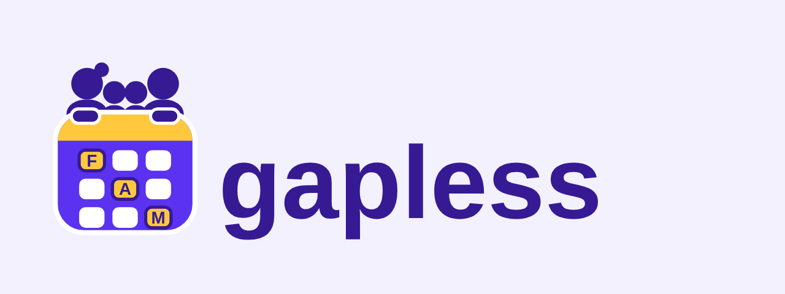

# Gapless: 10-slide pitch deck content

Figures marked **[assumption]** are our planning numbers, not data. Everything else has a source at the end. Demo numbers come from the live example, run on Nov 14, 2026.

---

## Slide 1: Title

**Gapless**
Every no-school day covered, for the least money and the fewest vacation days.

- Live: `https://YOUR-DEPLOY-URL` (opens straight into the tool, no sign-up)
- Code: `https://github.com/YOUR-TEAM/gapless`
- Track 01: Money

*Visual:* the logo, large. A family holding up the school calendar; the days they cover light up F-A-M.

---

## Slide 2: The user and the problem (15%)

**Who:** two working parents, 30 to 45, with kids in elementary or middle school. Both have jobs, both have limited vacation days, and neither has a free weekday.

**The math doesn't work:**
- US schools are closed about 29 weekdays during the school year, more than two weeks longer than the average private-sector worker gets in paid leave (CAP).
- With summer, schools are closed 83 weekdays a year, 67 more than a typical worker gets in paid vacation and holidays (CAP).
- Covering those days out of pocket would cost an average of $6,600 a year (CAP, 2016 figures).
- Some districts are worse. Fairfax County had 40 student days off in 2025–26, the most in Northern Virginia, and parents protested the 2026–27 calendar.

**And every school day:** school lets out mid-afternoon, work doesn't end until 5 or later. Someone has to do pickup and cover the rest of the afternoon, on about 180 school days a year.

**The acute moment:** the district publishes the calendar in August, the first teacher workday hits in September, and from then on it's a running group-chat negotiation: who takes off, is Grandma free, is camp worth it this week?

---

## Slide 3: Why this is new (10%)

We checked what exists before building.

| What exists | What it does | What it doesn't do |
|---|---|---|
| PTO calculators and "holiday optimizers" | Track one person's vacation balance, find long weekends | Know about school closures, kids or the other parent |
| Shared family calendars (LoopUsIn, Nestify) | Show the gaps; Nestify flags them with AI | Decide who covers which day, or what it costs |
| Camp directories, sitter apps | Sell one kind of care | Compare against vacation days, Grandma or another week |
| Singapore's school-holiday leave planner | Leave planning for Singapore's school breaks | US calendars, two parents, camps, costs, sick days |
| Co-parenting apps (OurFamilyWizard) | Custody calendar; schedule-change requests the other parent accepts or declines | Plan who covers no-school days, use right of first refusal before a sitter, or split the cost |

**Gapless is, as far as we could find, the first US tool that jointly optimizes all coverage sources across a whole school year.** Those sources are both parents' schedules and vacation days, a sick-day reserve, family help, camps by the week, and paid care by the day.

It is not an AI wrapper. It's a min-cost-flow optimizer, and every assignment can be checked by hand.

We don't claim the custody calendar itself is new: apps like OurFamilyWizard already have one, with change requests. What's new is joining it to the coverage plan.

---

## Slide 4: Live walkthrough, end to end, zero login (40%)

1. Open the URL. The tool is already there: the hero shows 83 school-closed weekdays vs. about 16 days off, then a 4-step setup (district → kids → parents → help) that builds a plan in about 30 seconds, on real 2026–27 calendars for NYC, Los Angeles, Chicago, Miami-Dade, Houston or Fairfax.
2. Click **Try with Realistic US Example**: Dana (ICU nurse, Mon–Wed shifts), Marcus (federal analyst, teleworks Mon/Fri), Ava (10), Leo (6), Grandma Linda (Tue/Wed), on the 2026–27 FCPS calendar. A 5-step tour walks through the plan (replay it any time with 🧭 Tour).
3. Instantly:
   - **72 no-school weekdays ahead.** 33 are covered free by someone's day off. **39 need a plan, and all are covered.**
   - **Cash: $1,840 vs. $6,810 the usual way.** Even counting every vacation day at $150, it's **$4,026 vs. $7,410**.
   - Plans you wouldn't come up with on your own:
     - winter camp only for Leo;
     - Ava home Mondays while Marcus teleworks;
     - Grandma saved for summer, where she's worth the most;
     - zero summer camp weeks, because Dana's Thu/Fri off makes them a bad deal.
4. **To-do** turns the plan into 14 dated tasks: ask for vacation 3 weeks ahead, confirm Grandma a week ahead, book the sitter, register for camp by its deadline. Each message is already written: tap **Write the text** for the sitter or Grandma, or **Write the email** for the vacation request, and it opens in Messages or Mail. **Add to calendar** downloads every task with a 9 am alert.
5. **What if…** re-plans five scenarios from scratch. Grandma can't help: +$1,770 cash, +$2,214 total cost. Keep 5 vacation days each for a trip: +$1,378 cash. The total cost counts vacation days, so it can rise even when cash falls.
6. Tap **Why?** on any day: "Dana takes a vacation day, which you value at $150. The cheapest paid option, Babysitter (9 h at $22), would cost $198. That's $48 better." Every choice is explained in the family's own numbers, with a Plan B if a helper or sitter cancels.
7. **Yes, show my savings** (Dependent Care FSA): about $552 back in taxes on the $1,840 plan at a 30% rate. The 2026 limit is $7,500 per household.
8. Tap **Kid is sick → Re-plan**: the day is covered from the sick-day reserve, and the plan adjusts.
9. **After school:** the usual week at a glance. Mondays $50 of after-care, Tuesday and Wednesday Grandma (Ava is at swim team on Wednesdays), Thursday and Friday Dana: $144 a month, $1,150 until summer. It also checks the $280 monthly after-care plan and says skip it. Then type "Carpool: the Parks drive Mondays, we drive Thursdays" into Ask Gapless: the carpool is worth it in 21 of 23 weeks and after school drops to $100 until summer. One tap on Undo puts it back.
10. **Ask Gapless** (bottom right): type "Grandma can't help in December", see what it understood, tap Apply: re-planned, "After school: +$225 until summer". Ask "What if Grandma can't help?" or "Who has the kids Dec 22?"
11. **Same family, two homes:** the parents are divorced, on a 2-2-5-5 schedule. Switch "I'm Dana / I'm Marcus" to see each side: when you next have the kids, 50% of the time, extra days through right of first refusal, a 60/40 cost split, and a day-change request that does nothing until the other parent approves.
12. Flip **Demo Unlock Pro**:
   - the whole year shows on the calendar;
   - **Download calendar** gives a real .ics file;
   - **Create partner link** opens the identical plan in another browser;
   - **Print / save as PDF** gives a one-page plan for the fridge.

Every number comes from the engine, running on what's on the screen. Change anything and it re-optimizes in about 40–60 ms.

---

## Slide 5: Engineering proof (40%)

**Architecture:** React + TypeScript + Tailwind, a static site with no backend. The engine (`src/engine/`) is about 1,460 lines of pure TypeScript.

**The pipeline:**
1. **Gap detection.** District closures plus summer, crossed with each parent's workdays and employer holidays.
2. **Min-cost flow** (a hand-written SPFA successive-shortest-path solver):
   - Resources (each parent's PTO, the sick-day reserve, WFH, Grandma) flow to days.
   - Paid care is each day's default, and an arc's cost is the money it saves.
   - Capacities are exact, and a vacation day is valued at what the family says it's worth.
3. **Camp-week local search** around the flow, per child and per sibling group. Booked weeks stay locked.
4. **Real rules:**
   - camps and drop-in care don't take sick kids;
   - drop-in programs may not run in summer;
   - the sick-day reserve only covers surprise days;
   - days nobody can cover are flagged, never hidden.
5. **Around the optimizer:**
   - two homes: custody patterns, holidays by year, approved-only day changes, right of first refusal as an extra flow source;
   - a to-do list derived from the plan, with lead times;
   - "what if" scenarios, each a full re-optimization;
   - every-school-day after-school planning: cheapest available pickup per afternoon, hourly sitter pricing with longer early-release days, kids who walk home or have activities, monthly after-care decided per month, carpool swaps decided per week;
   - "Ask Gapless": a keyword parser that turns plain English into proposed plan changes (confirmed before applying) or answers computed by the engine. No language model, so no data leaves the browser.
6. **I/O:**
   - RFC 5545 .ics import of district calendars;
   - .ics export;
   - compressed partner links in the URL fragment, so no server ever sees family data.

**Quality:** 65 tests. They include an exact flow check, every capacity rule, a check that the plan is never worse than the "usual way" from any start date, custody rules (a request can't be approved by the person who made it, and decisions are final), and checks that every district calendar holds only real weekdays. Strict TypeScript, zero secrets.

---

## Slide 6: Monetization (20%)

**Free:** 30-second setup, an optimized plan for the next 60 days, to-do reminders, what-if scenarios, two homes, sick-day re-plans, and the savings number.
**Family: $39 per school year, or $5.99/month.** The whole year and summer, the partner link, calendar export, and the printable plan.

- **Why they pay:** in our example the plan saves $4,970 in cash. The price is less than one day of a babysitter ($198 in the example).
- **The paywall hits at the moment of value.** The free tier shows the full-year savings number it already computed, with the calendar beyond 60 days blurred.
- **Seasonal timing:**
  - August, when the calendar drops;
  - January–February, when summer camp registration opens;
  - May, during summer panic.

---

## Slide 7: Retention loop (20%)

- **Daily:** every school day has a pickup plan ("After school": the usual week, Grandma on Tue/Wed, after-care only on Mondays). This isn't a once-a-season tool: it's the family's weekday schedule.
- **Weekly:** "Coming up" shows the next closures and who has the kids. The to-do list says what to arrange this week, and its calendar alerts bring parents back.
- **The habit moment:** a kid wakes up sick or school closes for snow. One tap re-plans the rest of the year, using the reserved sick days first.
- **Registration countdowns:** red when a camp deadline is under 3 weeks away. "Mark booked" locks a week in.
- **Two users per account:** the partner link brings in the second parent. Both open it when they argue about who's taking Friday off.
- **Every school year resets the problem**, so families renew.

- **Co-parents:** each parent opens the plan to see their own time and answer change requests.

*Next step:* email or push reminders, so alerts don't depend on a calendar import.

---

## Slide 8: Market and path to $100M ARR (15%)

- **Who it's for:** US families with school-age kids where every parent works. Our estimate is roughly 15–20M households [assumption: to verify against BLS Employment Characteristics of Families].
- **ARPU:** about $45/yr [assumption: a mix of $39/yr and $5.99/mo].
- **$100M ARR needs about 2.2M paying families**, roughly 11–15% of that segment.
- **How we get there:**
  - Distribution through district calendars: one landing page per district ("FCPS 2026–27: plan every day off"), so SEO scales with about 13,000 US districts [assumption: confirm district count].
  - Parent groups and PTAs.
  - Co-parents: two homes already works; next, per-child school calendars and booking commissions on camps.

---

## Slide 9: Unit economics (15%)

All figures here are [assumption].

- **Gross margin:** static site, no servers, no data costs. On $39/yr, about 95% after card fees.
- **LTV:** $39 × an average of 3 school years (kids stay in K–8 for years, and the problem recurs every year) ≈ **$110**.
- **Target CAC ≤ $25**, giving LTV:CAC of about 4–5:1.
- **Why CAC can stay low:**
  - The district landing pages are free, evergreen traffic.
  - The partner link adds a second user at no cost.
  - Parent Facebook groups share any useful "teacher workday" planner on their own.
- **Payback:** immediate on the annual plan.

---

## Slide 10: What we built in 24 hours

- A working product: zero login, a realistic example on a real district calendar, a guided tour, a 4-step setup on 6 real district calendars, and fully editable custom inputs.
- An engine with gap detection, a min-cost-flow optimizer, camp local search, an honest baseline, sick and snow-day re-planning, .ics import and export, and no-server partner links.
- **Every day, not just 83:** after-school pickups planned for every school day, and "Ask Gapless" for plain-English changes and questions.
- Features around it: a dated to-do list with calendar alerts, what-if scenarios, two homes for divorced parents, a printable plan, a "Why?" for every day, kids at different schools, early-release pickups, Dependent Care FSA tax savings, file backup, ready-to-send messages for every task, and a Plan B for every day.
- Retention: weekly lookahead, sick-day re-plan, registration countdowns, and a second parent per account.
- Brand: a logo from our own sketch (a family holding up the calendar), and a bright, friendly interface.
- Monetization: a free/Family split, a paywall at the moment of value, and a Demo Unlock for judges.
- Quality: 65 passing tests, strict TypeScript, no secrets, and a README that explains every modeling choice.
- **Next 30 days:**
  - Stripe Checkout;
  - prebuilt calendars for the 100 largest districts (6 today);
  - email and push reminders;
  - half-day scheduling for early-release afternoons.

---

## Sources

- Center for American Progress, "Workin' 9 to 5" (2016) and its press release: https://www.americanprogress.org/press/release-misaligned-school-and-work-schedules-are-costing-working-parents-and-the-u-s-economy-new-cap-analysis-finds/ and https://www.americanprogress.org/wp-content/uploads/sites/2/2016/09/working9to5_1016-summary.pdf
- Burke Connection, FCPS 2026–27 calendar and regional days-off counts: https://www.burkeconnection.com/news/2026/apr/14/fcps-board-approves-2026-27-school-year-calendar/
- FCPS 2026–27 closure dates (third-party compilation; verify at fcps.edu): https://publicschoolscalendar.com/fairfax-county-public-schools-calendar-2026-2027/
- School-break and drop-in care price ranges: https://daycarecostguide.com/guides/before-after-school-care-costs
- OurFamilyWizard calendar and schedule-change requests: https://www.ourfamilywizard.com/blog/myths-about-ourfamilywizard-calendar
- Dependent Care FSA limit of $7,500 for 2026: https://www.kiplinger.com/taxes/new-fsa-contribution-limits
- Miami-Dade and Houston ISD 2026–27 calendars as listed on agendahero.com: https://agendahero.com/page/fl-miamidade-2026-27, https://agendahero.com/page/tx-houston-isd-2026-27
- District calendars 2026–27: NYC (https://www.schools.nyc.gov/calendar/2026-2027-school-year-calendar), LAUSD and Chicago as listed on agendahero.com (https://agendahero.com/page/ca-los-angeles-unified-2026-27, https://agendahero.com/page/il-chicago-2026-27), CPS board action (https://www.cpsboe.org/content/actions/2026_02/26-0226-ED1.pdf)
- Competitors reviewed: LoopUsIn (https://www.loopusin.app/blog/school-break-care-jigsaw), Nestify (https://www.nestifyapp.org/blog/summer-childcare-patchwork-schedule-working-parents), SG school-holiday planner (https://sgschoolholidays.com/childcare-gap), PTO calculators (e.g., https://pto-planner.com/)
